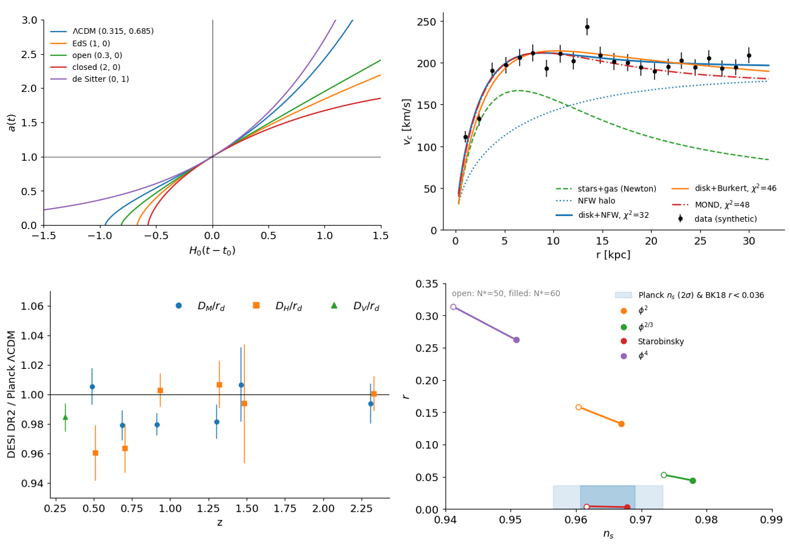

<div dir="rtl">

# מבוא לקוסמולוגיה: רשימות הרצאה, מחברות ותרגילים

קורס מבוא של 9 שעות (שלושה מפגשים של 3 שעות) לשנה ג' בפיזיקה ולתואר שני. הקורס כולל רשימות הרצאה בעברית (LaTeX), מחברת Python לכל הרצאה עם דוגמאות ותרגילים פתורים, שלושה תרגילי בית, וצנרת MCMC מלאה לנתוני הסופרנובות של Pantheon+.

דוד בניסטי, אוניברסיטת בר-אילן

</div>



<div dir="rtl">

## מבנה

| הרצאה | נושא | רשימות | מחברת |
|---|---|---|---|
| 1 | משוואות פרידמן, גיל, מרחקים | [`L1_friedmann.tex`](lecture_notes/L1_friedmann.tex) | [`01_friedmann_distances`](notebooks/01_friedmann_distances.ipynb) |
| 2 | הסקה בייסיאנית, MCMC, סופרנובות Pantheon+ | [`L2_mcmc_sn.tex`](lecture_notes/L2_mcmc_sn.tex) | [`02_mcmc_pantheon`](notebooks/02_mcmc_pantheon.ipynb) |
| 3 | גדילת הפרעות, אורך ג'ינס, הרשת הקוסמית | [`L3_structure.tex`](lecture_notes/L3_structure.tex) | [`03_growth_structure`](notebooks/03_growth_structure.ipynb) |
| 4 | חומר אפל: ויריאל, קריסה כדורית, טיעון התזמון, עקומות סיבוב, NFW, MOND | [`L4_dm_evidence.tex`](lecture_notes/L4_dm_evidence.tex) | [`04_dark_matter`](notebooks/04_dark_matter.ipynb) |
| 5 | רקומבינציה, אופק הקול, $\theta_\star$, BAO של DESI DR2 | [`L5_cmb_bao.tex`](lecture_notes/L5_cmb_bao.tex) | [`05_cmb_bao`](notebooks/05_cmb_bao.ipynb) |
| 6 | אינפלציה: slow roll, $n_s$, $r$ | [`L6_inflation.tex`](lecture_notes/L6_inflation.tex) | [`06_inflation`](notebooks/06_inflation.ipynb) |

* [`lecture_notes/cosmo_lectures.pdf`](lecture_notes/cosmo_lectures.pdf): כל הרשימות בקובץ אחד, כולל תרגילים ופתרונות בכיתה.
* [`homework/`](homework/): שלושה תרגילי בית (4 שאלות × 25 נק'). רוב השאלות אנליטיות; שאלות מחשב ב-hw2 (MCMC) וב-hw3 (עקומת סיבוב).
* [`pantheon_plus_analysis/`](pantheon_plus_analysis/): אותו ניתוח של הרצאה 2 כסקריפטים, עם דוגם Metropolis–Hastings שנכתב מאפס.

בכל מחברת יש קודם דוגמאות שמלוות את ההרצאה, ואחריהן **תרגילים פתורים נוספים** שאינם ברשימות.

## הרצה

</div>

```bash
pip install -r requirements.txt
jupyter lab notebooks/
```

<div dir="rtl">

מחברת 2 מורידה בהרצה הראשונה את נתוני Pantheon+ (כ-34MB) ומריצה כ-10 דקות. שאר המחברות רצות תוך שניות.

**קומפילציה של הרשימות:** `lualatex cosmo_lectures.tex` פעמיים, מתוך `lecture_notes/` (נדרשים `luaotfload` וגופן עברי: David CLM, David, או FreeSerif כגיבוי). תרגילי הבית: `lualatex hw1.tex` מתוך `homework/`.

## מקורות נתונים

* Pantheon+: Scolnic et al. 2022, ApJ 938, 113; Brout et al. 2022, ApJ 938, 110
* DESI DR2 BAO: DESI Collaboration 2025, arXiv:2503.14738
* Planck 2018: A&A 641, A6 (2020); A&A 641, A10 (2020)
* BICEP/Keck 2018: PRL 127, 151301 (2021)

</div>

---

**English summary.** A 9-hour introductory cosmology course (in Hebrew): LaTeX lecture notes, one Jupyter notebook per lecture with worked examples and extra solved problems (Friedmann equations and distances, Bayesian inference and MCMC on Pantheon+, linear growth, dark-matter evidence, CMB acoustic scale and DESI DR2 BAO, inflation), three homework sets, and a stand-alone Pantheon+ MCMC pipeline. Install with `pip install -r requirements.txt`.
